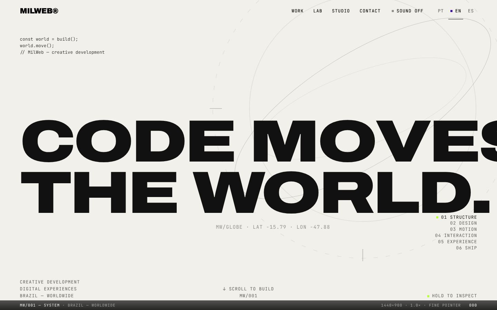

# MilWeb

[Português](README.pt-BR.md)

Website and portfolio of MilWeb, Rick's studio (custom websites, landing pages, online stores and web systems).

> **Type:** production — MilWeb's commercial website. Live at <https://milweb.com.br>



## Stack

- Next.js 15.5 (App Router) with React 19 and TypeScript
- Tailwind CSS 3
- GSAP and Lenis for animation and scrolling
- Three.js with React Three Fiber for the hero visual
- Content in three languages (pt, en, es) with routes in `src/app/[lang]`
- Deployed on Vercel (region `gru1`, see `vercel.json`)

## Running

Requires Node.js 18.18 or newer (Vercel uses Node 24) and pnpm.

```bash
pnpm install
pnpm dev      # development server
pnpm build    # production build
pnpm start    # serve the build
pnpm lint
```

## Environment variables

None are required to run locally.

| Variable | Use | Default |
| --- | --- | --- |
| `NEXT_PUBLIC_SITE_URL` | Public URL used in metadata, sitemap and canonical links | `https://milweb.com.br` |
| `NEXT_PUBLIC_HERO_VISUAL` | Hero visual: `globe` or `compiler` | `globe` |

## Structure

- `src/app/[lang]`: pages (services, work, lab, studio, contact, diagnosis and service pages)
- `src/i18n`: text for each language
- `src/components`, `src/features`: site components and blocks
- `scripts/`: QA checks with Playwright (i18n, motion, navigation, orphan assets)

CI (`.github/workflows/ci.yml`) runs `pnpm lint` and `pnpm build` with read-only permissions.

## Media

- `public/shots/`: screenshots of MilWeb's own projects, with demo data.
- `public/lab/` and the videos in `public/shots/`: creative-lab pieces; the origin and license of each video still need to be documented.
- Inter font (SIL Open Font License).

## Security and license

See [SECURITY.md](SECURITY.md). No open-source license: code and content are all rights reserved by MilWeb.
